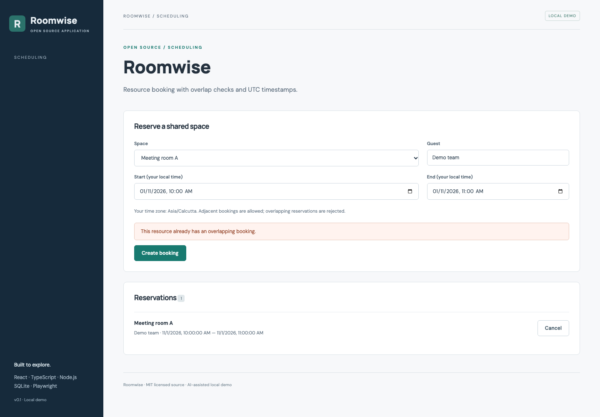

# Roomwise

Resource scheduling. An independently runnable open source application.

## Run and demonstrate

From this repository, run `npm ci` and `npm run dev`. Open http://127.0.0.1:5173/#booking.

Book a room for a one-hour interval. Attempt an overlapping booking and observe the conflict error. An adjacent booking is allowed. Cancel a reservation and rebook the interval.

## Implementation and decisions

Times are normalized to UTC. An overlap exists when an existing start is before the new end and its end is after the new start. The overlap check and insertion share a transaction. Calendar dates and interval order are validated.

API implementation: [`server/projects/booking.ts`](server/projects/booking.ts). The React workflow is in [`src/main.tsx`](src/main.tsx); storage initialization and shared middleware are in [`server/app.ts`](server/app.ts).

## API

- `GET /api/bookings` — list reservations.
- `POST /api/bookings` — create `{resource, guest, starts_at, ends_at}` with ISO UTC timestamps; returns HTTP 409 on overlap.
- `DELETE /api/bookings/:id` — cancel a reservation.

## Verification

Run `npm test` for domain/API checks. Run `npm run build`, then `npm run test:e2e` for browser flows, including **Roomwise rejects double booking and supports cancellation**.

## Application description

> Roomwise: a resource scheduling application with UTC-normalized reservations, transactional overlap checks, cancellation, and regression coverage for overlapping, contained, adjacent, and invalid time intervals.

Use this as a description of the current project. Add your own reviewed contribution and disclose AI assistance when discussing development. Do not attach invented employment dates, client claims, production usage, or years of experience.

## Next contribution

Add per-resource opening hours and reject bookings outside those hours with boundary tests.

MIT licensed. Initial implementation created with AI assistance in October 2026; see [CONTRIBUTIONS.md](CONTRIBUTIONS.md).

## Scope

This is a single-user local demonstration with fictional data. It has no account authentication or multi-tenant authorization. Keep it bound to loopback. Initial code was developed with AI assistance in October 2026 and extracted from Portfolio Workbench.
